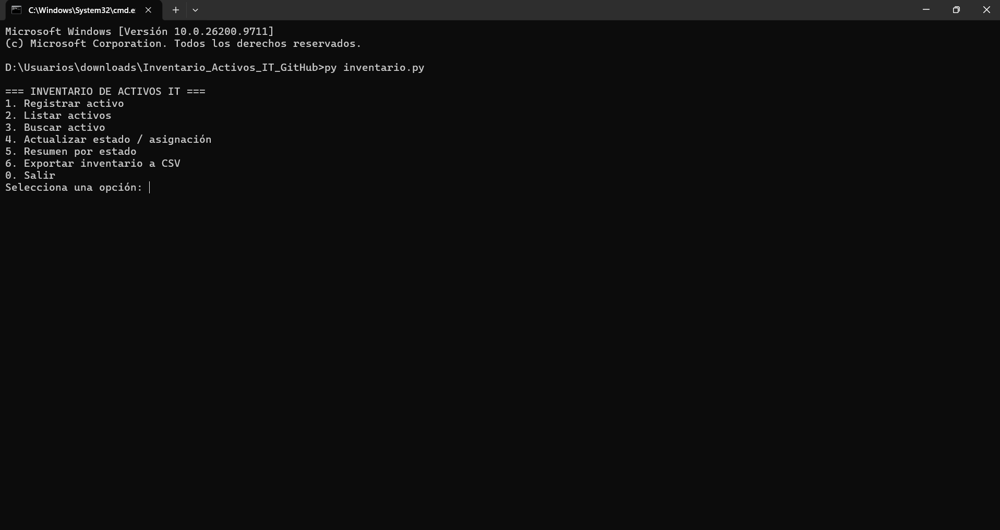
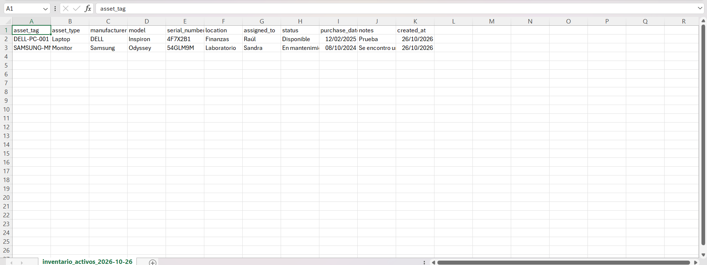
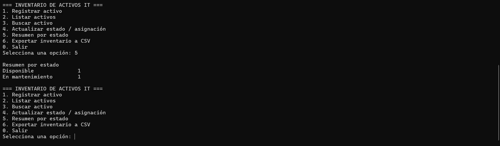

# Inventario de activos IT

Aplicación de consola para administrar un inventario informático ficticio. Proyecto personal de práctica creado para reforzar Python, SQL y tareas habituales de inventario de TI.

## Funcionalidades

- Registrar laptops, computadoras de escritorio, monitores, impresoras y equipos de red.
- Validar campos obligatorios, tipos, estados y fechas.
- Aceptar variantes de mayúsculas/minúsculas en tipo y estado, y guardar valores normalizados.
- Evitar etiquetas de activo duplicadas.
- Buscar por etiqueta, número de serie, fabricante, modelo, área o responsable.
- Filtrar activos por estado y cambiar estado/asignación.
- Conservar al responsable actual, asignar otra persona o quitar la asignación de forma explícita.
- Generar resumen de activos agrupados por estado.
- Exportar los registros a CSV compatible con Excel.
- Ejecutar pruebas automatizadas sobre una base de datos temporal.

## Tecnologías

- Python 3.10 o posterior
- SQLite y SQL
- Módulo `csv` de Python
- `unittest` para pruebas

No se requieren dependencias externas para ejecutar la aplicación.

## Requisitos y ejecución (Windows)

1. Instala Python 3.10 o posterior desde [python.org](https://www.python.org/downloads/).
2. Abre una terminal en la carpeta del proyecto.
3. Ejecuta:

```powershell
py inventario.py
```

La aplicación crea la base de datos `data/inventario_it.db` cuando la ejecutas. Al elegir la opción de exportación, genera el CSV dentro de `exports/`. Esos archivos de ejecución están excluidos de Git mediante `.gitignore`.

## Ejecutar las pruebas

Desde la raíz de este repositorio:

```powershell
py -m unittest discover -s tests -v
```

Las pruebas utilizan una base SQLite temporal, de modo que no necesitan ni modifican el inventario que uses en la aplicación.

## Estructura

```text
inventario-activos-it/
├── inventario.py
├── README.md
├── .gitignore
└── tests/
    └── test_inventario.py
```

## Conceptos técnicos demostrados

- Operaciones CRUD (crear, consultar y actualizar registros).
- Diseño de tablas, clave primaria, restricción de unicidad e índices.
- Consultas SQL parametrizadas.
- Validación y normalización de entradas.
- Manejo de errores y persistencia con SQLite.
- Agregaciones con `GROUP BY` y exportación CSV.
- Pruebas unitarias con aislamiento de datos.

## Prueba manual sugerida

1. Registra una laptop y una computadora de escritorio con distintas áreas y responsables.
2. Busca un activo por su etiqueta.
3. Cambia el estado a `En mantenimiento` y verifica que el responsable se conserve al presionar Enter.
4. Consulta el resumen por estado y exporta el inventario a CSV.
5. Cierra y abre de nuevo el programa para verificar la persistencia de los datos.

## Limitaciones y mejoras futuras

Es una aplicación de consola para un entorno ficticio. No incluye autenticación, permisos multiusuario ni conexión con un sistema real de inventario. Posibles mejoras: historial de mantenimiento, roles y auditoría, interfaz gráfica o web, y reportes adicionales.

## Capturas de pantalla

### Menú principal


### Inventario exportado a Excel


### Resumen de activos por estado
